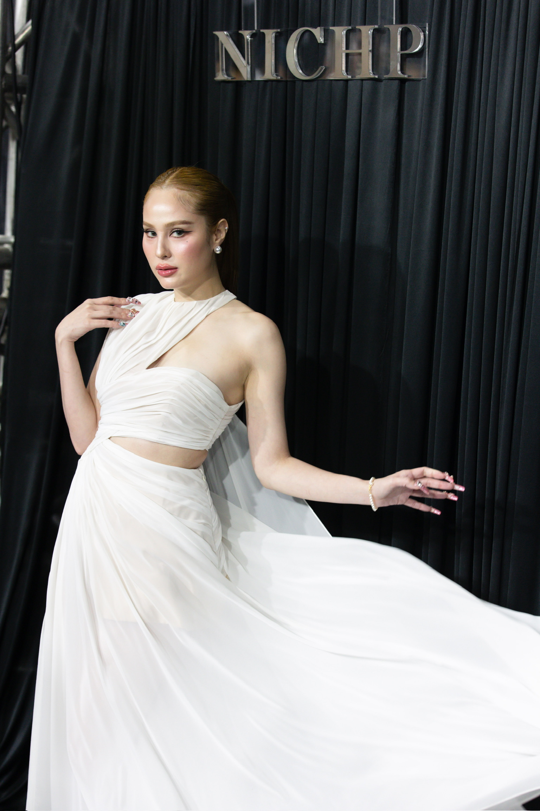
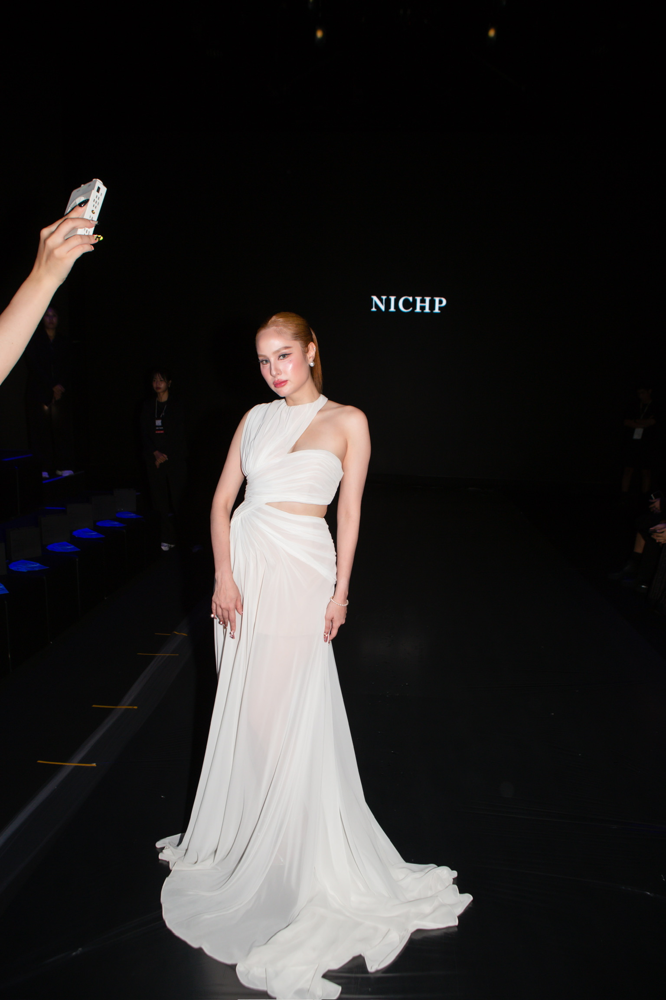
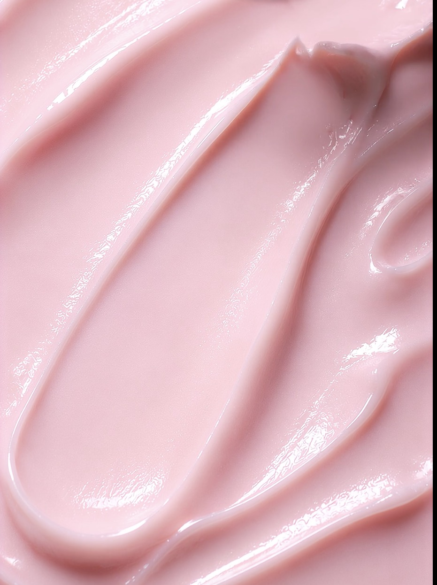

# D1 · "ยกแขนได้ไม่ต้องคิด" — ฉบับกลางวัน + กลางคืน · CTA ให้เม้นแล้วแอดมินทักไป

**สินค้า:**
- ☀️ กลางวัน: **UZI Barbie Clear & Fresh Underarm Mask** 40 g (หลอด)
- 🌙 กลางคืน: **UZI Underarm White Shot Mask** 7 g (ซอง 59.-)

**แพลตฟอร์ม:** Facebook / Instagram Reels / TikTok · 9:16 · 1080×1920 · ความยาว 40–45 วินาที
**โทนคลิป:** นางแบบตามภาพอ้างอิง (หัวข้อ "นางแบบ" ด้านล่าง) พูดหน้ากล้องเหมือนเล่าให้เพื่อนฟัง (UGC) แต่ลุคยังดูแพง ใช้แสงธรรมชาติตอนกลางวัน และไฟวอร์มสลัวตอนกลางคืน คุมโทนชมพู–ขาว
**CTA:** ให้คนดูคอมเมนต์คำว่า **"มาสก์รักแร้"** แล้วแอดมินทักแชทไปส่งรายละเอียดและปิดการขายในแชท
**เป้าหมาย:** Hook Rate (ดูถึง 3 วิ) > 30% · ได้คอมเมนต์ต้นทุนต่ำ · แอดมินปิดเซ็ตเช้า–คืนในแชท เพื่อดันยอดต่อบิลให้ได้ ROAS 10+

**โครงเรื่อง:** ปัญหา (หนีบแขน) → ☀️ เช้า: Barbie ดูแลระหว่างวัน → 🌙 คืน: White Shot ฟื้นบำรุงข้ามคืน → ผลลัพธ์ (ยกแขนได้มั่นใจ) → ชวนเม้น "มาสก์รักแร้"

---

## อุปกรณ์ / ฉาก / นักแสดง

- **นักแสดง:** นางแบบตามภาพอ้างอิงด้านล่าง 1 คน (หน้าต้องเป็นคนเดียวกันทุกช็อต) และเพื่อน 1 คนเป็นตัวประกอบในช็อตโบกมือ ให้หันหลังหรืออยู่นอกโฟกัส เพื่อไม่ให้แย่งซีน
- **ฉาก:**
  - ① คาเฟ่หรือหน้าตึก (ข้างนอก)
  - ② โต๊ะเครื่องแป้งที่มีกระจก ช่วงเช้าแสงหน้าต่าง
  - ③ ห้องนอนตอนกลางคืน ไฟโคมหัวเตียง
  - ④ ข้างหน้าต่างตอนเช้าวันถัดไป
- **พร็อพ:** Barbie 1 หลอด, White Shot 7 ซอง, ดอกกุหลาบชมพู, ผ้าขาว, ถาดอะคริลิก, หมอนหรือผ้าปูสีขาว, มือถือ (ใช้ในช็อต CTA)

---

## นางแบบ (ภาพอ้างอิง — หน้าต้องเหมือน)

**ใช้นางแบบคนนี้คนเดียวตลอดทั้งคลิป** หน้าต้องเหมือนกันทุกช็อต ทั้งช่วงกลางวัน กลางคืน และ CTA
นางแบบคนนี้ยังตรงกับหน้าที่อยู่บนซอง White Shot ด้วย คนดูจะจำได้ทันทีว่าเป็นหน้าแบรนด์

**ลุคหลัก (ยึดตามภาพอ้างอิง)**
- **ผม:** สีน้ำตาลทองแดงอมส้ม เกล้าตึงไปด้านหลังเป็นหางม้าสูง ผมเรียบเงา แสกกลาง
- **หน้า:** ผิวโกลว์ฉ่ำ (dewy) มีไฮไลต์โหนกแก้มชัด ตาเป็นอายไลเนอร์หางเฉียงยาว ขนตาหนา คิ้วเข้มเป็นทรง ปากชมพูนู้ดฉ่ำวาว
- **เครื่องประดับ:** ต่างหูมุกเม็ดกลม และสร้อยข้อมือมุก
- **เล็บ:** เล็บยาวทรงอัลมอนด์ ในภาพเป็นลายเพชรหลายสี แต่วันถ่ายแนะนำให้เปลี่ยนเป็นสีชมพูนู้ด หรือ french มุก เพื่อไม่ให้แย่งสายตาจากเนื้อครีมชมพูในช็อต macro
- **คาแรกเตอร์:** มั่นใจ ดูหรู พูดเป็นกันเอง

**ชุดแต่ละช่วง**
| ช่วง | ชุด | หน้า/ผม |
|---|---|---|
| ช็อต 1–3 (ปัญหา) | เสื้อแขนกุดขาวคอสูง (halter) | ลุคหลัก แต่ลดความเข้มลง 20% |
| ☀️ กลางวัน (ช็อต 5–7) | เสื้อแขนกุดขาว ผ้าพลิ้ว | ลุคหลัก แสงธรรมชาติ |
| 🌙 กลางคืน (ช็อต 8–10) | ชุดนอนผ้าซาตินสายเดี่ยวสีชมพูอ่อนหรือขาว | ปล่อยผมหรือมัดต่ำ แต่งหน้าเบาลง (ยังต้องจำหน้าได้ชัด) |
| ผลลัพธ์ (ช็อต 11–12) | **ชุดราตรีขาวแบบในภาพอ้างอิง** (halter ไหล่เดียว เว้าเอว ผ้าชีฟองพลิ้ว) | ลุคหลักเต็มที่ ตามภาพ |
| CTA (ช็อต 13–14) | ชุดราตรีขาวชุดเดิม | ลุคหลักเต็มที่ |

**ภาพอ้างอิงนี้ใช้เป็นช็อตผลลัพธ์ได้เลย:** ลุคชุดราตรีขาวเปิดไหล่ที่ยกแขนอย่างมั่นใจ คือภาพ "ยกแขนได้ไม่ต้องคิด" ที่เป็นจุดจบของเรื่อง

**ข้อตกลงก่อนใช้**
- ต้องมีสัญญาหรือหนังสือยินยอมให้ใช้หน้าและภาพของนางแบบในโฆษณาแบบยิงแอดก่อนเสมอ ระบุแพลตฟอร์มและระยะเวลาให้ชัด
- ถ้าจะใช้ AI สร้างหรือขยายภาพจากหน้าของนางแบบ ต้องได้รับอนุญาตจากนางแบบสำหรับการใช้ AI โดยเฉพาะ และติดป้าย "AI-generated" ตามนโยบายของ TikTok และ Meta
- ภาพอ้างอิงมีโลโก้แบรนด์อื่น (NICHP) อยู่ในฉาก ห้ามใช้ภาพนี้ในแอดตรงๆ ต้องถ่ายใหม่ในฉากของ UZI เอง

---

## เนื้อครีม (ภาพอ้างอิง)

- **สี:** ชมพูพาสเทลอ่อน (baby pink) เนื้อเนียน ไม่มีเม็ดหรือกากเพชร
- **ผิวสัมผัส:** ครีมเงาฉ่ำ ปาดแล้วเป็นลอนนุ่ม ขอบเนื้อครีมเป็นเงาสะท้อนแสง
- **วิธีถ่าย Macro:**
  - ใช้ไฟ softbox ส่องจากด้านข้างหรือเฉียงหลัง เพื่อให้เห็นเงาฉ่ำตามลอนครีม
  - พื้นหลังสีขาวหรือชมพูอ่อน
  - ปาดครีมเป็นลอนบนแผ่นอะคริลิกใสให้ได้แบบภาพอ้างอิงนี้ ใช้เป็นช็อตแทรก (B-roll) ได้ทั้งช่วงกลางวันและกลางคืน
- **บาลานซ์คำว่า "บางเบา":** ภาพลอนครีมดูเข้มข้น ต้องตามด้วยช็อตเกลี่ยบนผิวให้เห็นว่าบาง และซึมหายภายใน 2–3 วินาที คนดูจะได้ไม่คิดว่าเนื้อหนักหรือเหนอะ
- **เกรดสี:** ห้ามให้สีเนื้อครีมเพี้ยน เพราะครีมต้องเป็นชมพูอ่อนตรงกับของจริงในทุกช็อต รวมถึงช่วงกลางคืนที่ใช้ไฟวอร์ม ต้องคุม white balance ไม่ให้ครีมกลายเป็นสีส้มหรือสีพีช

---

## สคริปต์ถ่ายทำทีละช็อต

| # | เวลา | ช็อต / กล้อง | เสียงพูด (VO) | ข้อความบนจอ | เสียงประกอบ |
|---|---|---|---|---|---|
| 1 | 0.0–1.5 | **WOW** · Medium ระดับสายตา ข้างนอก นางแบบใส่เสื้อ halter ขาว เพื่อนเรียกจากนอกเฟรม เธอเริ่มยกแขนจะโบก | (เพื่อน) "เฮ้ย! ทางนี้!" | — | เสียงคนคุยในคาเฟ่ |
| 2 | 1.5–3.0 | Close-up ใบหน้าที่ชะงัก แล้วรีบหุบแขนลง เปลี่ยนเป็นโบกแค่ข้อมือแบบเขินๆ | "…" | **ใส่แขนกุดแล้วต้องหนีบแขนทั้งวัน?** (ตัวใหญ่ กลางจอ) | Record scratch |
| 3 | 3–7 | Jump cut ไปที่โต๊ะเครื่องแป้ง เธอพูดหน้ากล้อง | "ใครเป็นแบบนี้บ้าง… ใต้วงแขนหมอง ไม่เรียบ แถมเหงื่อออกทีไรกลัวกลิ่นตลอด" | **หมอง · ไม่เรียบ · กลัวกลิ่น** (เด้งขึ้นทีละคำ) | เพลง lo-fi เริ่ม |
| 4 | 7–9 | Split screen ☀️ ซ้าย หลอด Barbie / 🌙 ขวา ซอง White Shot | "เคล็ดลับคือต้องดูแลให้ครบ ทั้งกลางวันและกลางคืน" | **☀️ กลางวันดูแล · 🌙 กลางคืนฟื้นบำรุง** | Whoosh |
| — | — | **— ☀️ ช่วงกลางวัน —** | | | |
| 5 | 9–12 | **OFFER ☀️** · แสงเช้าจากหน้าต่าง หยิบหลอด Barbie ชิดกล้อง หมุนให้แสงตกกระทบเงามุก | "เช้า ใช้ Barbie Clear & Fresh ของ UZI" | **☀️ AM · Barbie Clear & Fresh** | เสียงวิ้ง |
| 6 | 12–15 | Macro ปาดเนื้อครีมชมพูพาสเทลเงาฉ่ำเป็นลอน (ตามภาพอ้างอิง) → บีบลงปลายนิ้ว → เกลี่ยใต้วงแขนจนซึมหาย | "เนื้อบางเบา ซึมไว ไม่เหนอะ ทั้งบำรุงผิว ทั้งช่วยดูแลกลิ่น ในขั้นตอนเดียว" | **บางเบา · ซึมไว · ดูแลกลิ่น** | ASMR เสียงบีบครีม |
| 7 | 15–18 | Timer บนจอ 3…2…1 แล้วสวมเสื้อขาวทันที ซูมให้เห็นว่าไม่มีคราบ | "ทาปุ๊บใส่เสื้อได้เลย สดชื่นทั้งวัน" | **ใส่เสื้อได้ทันที ✔️** | เสียงติ๊กนาฬิกา |
| — | — | **— 🌙 ช่วงกลางคืน —** | | | |
| 8 | 18–20 | Transition (ไฟห้องดับ แล้วเปิดโคมหัวเตียง) ห้องนอนไฟวอร์ม ฉีกซองชมพูใกล้กล้อง | "ส่วนกลางคืน ปล่อยให้ White Shot Mask ทำงานตอนเราหลับ" | **🌙 PM · White Shot Mask** | ASMR เสียงฉีกซอง |
| 9 | 20–24 | Macro บีบครีมชมพูพาสเทลจากซองลงนิ้ว (ไฟโคมส่องข้างให้เห็นเงาฉ่ำ) → ทาบางๆ ใต้วงแขน | "สูตรเข้มข้น Niacinamide 8% NAG 4% กับ Rose's Stem Cell ทาทิ้งไว้ข้ามคืน ไม่ต้องล้างออก" | **Niacinamide 8% · NAG 4% · Rose's Stem Cell** | — |
| 10 | 24–26 | ล้มตัวนอนบนหมอนขาว ดึงผ้าห่ม | "เนื้อบางเบา ไม่เลอะหมอน" | **ไม่ต้องล้างออก 💤** | เพลงเบาลง |
| — | — | **— ผลลัพธ์ —** | | | |
| 11 | 26–30 | **ANGEL** · ตัดไปเช้าวันถัดไป แสงแดดเข้าหน้าต่าง ยกแขนส่องกระจกแล้วยิ้ม → Transition (สะบัดผ้า) เป็นลุคชุดราตรีขาว | "ใช้ต่อเนื่องเช้า–คืน ใต้วงแขนแลดูกระจ่างใส ผิวดูเรียบเนียน ตุ่มหนังไก่ก็ดูจางลง" | **แลดูกระจ่างใส · เรียบเนียน** | Beat drop |
| 12 | 30–33 | นางแบบในชุดราตรีขาว (ตามภาพอ้างอิง) หมุนตัวให้กระโปรงพลิ้ว แล้วยกแขนขึ้นจัดผมหางม้าอย่างมั่นใจ ตัดสลับกับช็อตโบกเพื่อนเต็มแขนในฉากเดียวกับช็อต 1 | "ตอนนี้ยกแขนได้ไม่ต้องคิดแล้ว" | — | — |
| — | — | **— CTA —** | | | |
| 13 | 33–37 | **CTA** · นางแบบในชุดราตรีขาวพูดหน้ากล้อง ถือหลอด Barbie กับซอง White Shot ไว้คนละมือ (ให้หน้าบนซองอยู่ในเฟรมคู่กับหน้าจริง) | "ใครที่มีปัญหาใต้วงแขนหมอง ไม่เรียบ หรือกลัวกลิ่นเหมือนกัน…" | **ใครมีปัญหาแบบนี้ 🙋‍♀️** | เพลงเบาลง |
| 14 | 37–42 | ชี้ลงไปที่ช่องคอมเมนต์ แล้วตัดภาพเป็นมือถือที่กำลังพิมพ์คำว่า "มาสก์รักแร้" (screen record หรือกราฟิกจำลองช่องคอมเมนต์) | "เม้นคำว่า 'มาสก์รักแร้' ไว้ได้เลย เดี๋ยวแอดมินทักไปส่งรายละเอียดเซ็ตเช้า–คืนให้นะคะ" | **💬 เม้น "มาสก์รักแร้"** (ตัวใหญ่) / **แอดมินทักไปส่งรายละเอียดให้** / ตัวเล็ก: *ผลลัพธ์ขึ้นอยู่กับแต่ละบุคคล · ควรทดสอบก่อนใช้* | เสียงแจ้งเตือนแชท ding |

---

## บทพูดต่อเนื่อง (ส่งให้นักแสดงหรือพากย์ได้เลย)

> (เพื่อน) เฮ้ย! ทางนี้!
> …
> ใครเป็นแบบนี้บ้าง… ใต้วงแขนหมอง ไม่เรียบ แถมเหงื่อออกทีไรกลัวกลิ่นตลอด
> เคล็ดลับคือต้องดูแลให้ครบ ทั้งกลางวันและกลางคืน
>
> ☀️ เช้า ใช้ Barbie Clear & Fresh ของ UZI
> เนื้อบางเบา ซึมไว ไม่เหนอะ ทั้งบำรุงผิว ทั้งช่วยดูแลกลิ่น ในขั้นตอนเดียว
> ทาปุ๊บใส่เสื้อได้เลย สดชื่นทั้งวัน
>
> 🌙 ส่วนกลางคืน ปล่อยให้ White Shot Mask ทำงานตอนเราหลับ
> สูตรเข้มข้น Niacinamide 8% NAG 4% กับ Rose's Stem Cell ทาทิ้งไว้ข้ามคืน ไม่ต้องล้างออก
> เนื้อบางเบา ไม่เลอะหมอน
>
> ใช้ต่อเนื่องเช้า–คืน ใต้วงแขนแลดูกระจ่างใส ผิวดูเรียบเนียน ตุ่มหนังไก่ก็ดูจางลง
> ตอนนี้ยกแขนได้ไม่ต้องคิดแล้ว
>
> ใครที่มีปัญหาใต้วงแขนหมอง ไม่เรียบ หรือกลัวกลิ่นเหมือนกัน…
> เม้นคำว่า "มาสก์รักแร้" ไว้ได้เลย เดี๋ยวแอดมินทักไปส่งรายละเอียดเซ็ตเช้า–คืนให้นะคะ

ถ้าพูดด้วยจังหวะเร็วแบบ TikTok จะยาวประมาณ 40–42 วินาที

---

## Hook สำหรับ A/B Test (เปลี่ยนเฉพาะช็อต 1–2 ส่วนที่เหลือใช้ของเดิม)

| ชุด | ภาพ 0–3 วิ | ข้อความบนจอ / เสียงพูด |
|---|---|---|
| A (ต้นฉบับ) | กำลังจะโบกแขน แล้วรีบหุบลง | ใส่แขนกุดแล้วต้องหนีบแขนทั้งวัน? |
| B | Split screen พระอาทิตย์ / พระจันทร์ ยกแขนพร้อมกันทั้งสองฝั่ง | "รักแร้ต้องดูแล 24 ชม. ไม่ใช่แค่ตอนเช้า" |
| C | ยืนจับราวในรถไฟฟ้า แล้วรีบเอาแขนลง | "จับราว BTS ทีไร ต้องคิดหนักทุกที" |
| D | ถ่ายรูปกลุ่ม ทุกคนชูมือ มีเธอคนเดียวที่ไม่ชู | "รูปกลุ่มที่เราไม่เคยกล้าชูมือ" |
| E | ชูหลอดกับซองขึ้นมาคู่กันตรงหน้ากล้อง | "2 ตัวนี้ เช้าตัวนึง คืนตัวนึง ใต้วงแขนเปลี่ยนเลย" |

---

## ระบบหลังบ้าน: จากคอมเมนต์ไปปิดการขายในแชท

### 1. คอมเมนต์ปักหมุด (โพสต์ทันทีที่แอดขึ้น)

> 💬 เม้นคำว่า **"มาสก์รักแร้"** ไว้ใต้โพสต์นี้ได้เลยค่ะ แอดมินจะทักแชทไปส่งรายละเอียดเซ็ตเช้า–คืน + โปรวันนี้ให้นะคะ 🌸☀️🌙

### 2. ตอบใต้คอมเมนต์ (ตั้ง auto-reply หรือให้แอดมินตอบเอง)

> ได้เลยค่ะคุณ [ชื่อ] 💕 แอดมินส่งรายละเอียดไปทางแชทแล้วนะคะ เช็กกล่องข้อความได้เลยค่ะ 📩

ช่วยให้คนอื่นเห็นว่ามีคนตอบจริง และกระตุ้นให้คนดูเม้นตามมากขึ้น

### 3. ข้อความแรกที่ส่งไปในแชท (Private Reply)

> สวัสดีค่ะคุณ [ชื่อ] 🌸 แอดมินจาก UZI Cosmetic นะคะ ขอบคุณที่สนใจมาสก์รักแร้ค่ะ
>
> ☀️ **กลางวัน – Barbie Clear & Fresh Underarm Mask (40 g)**
> เนื้อบางเบา ซึมไว ดูแลผิวใต้วงแขนให้แลดูเรียบเนียน + ช่วยดูแลกลิ่นให้สดชื่นทั้งวัน
>
> 🌙 **กลางคืน – Underarm White Shot Mask (7 g)**
> Niacinamide 8% + NAG 4% + Rose's Stem Cell ทาทิ้งไว้ข้ามคืน ให้ผิวใต้วงแขนแลดูกระจ่างใส
>
> 🎁 **โปรวันนี้**
> 1️⃣ เซ็ตเช้า–คืน: Barbie 1 + White Shot [x] ซอง = [ราคาโปร] ส่งฟรี
> 2️⃣ เซ็ต 7 คืน: White Shot 7 ซอง = [ราคาโปร]
> 3️⃣ ลองก่อน: White Shot 1 ซอง 59.-
>
> คุณ [ชื่อ] กังวลเรื่องไหนมากที่สุดคะ หมองคล้ำ ผิวไม่เรียบ หรือเรื่องกลิ่น แอดมินจะช่วยแนะนำเซ็ตที่เหมาะให้ค่ะ 💕

### 4. แนวปิดการขายของแอดมิน (เพื่อดันยอดต่อบิล)

- **ถามปัญหาก่อนเสนอราคาเสมอ:** แล้วจับคู่ปัญหากับโปร เช่น กลัวกลิ่น → เน้น Barbie, หมองหรือตุ่มหนังไก่ → เน้น White Shot, มีหลายปัญหา → เซ็ตเช้า–คืน
- **เสนอเซ็ตเช้า–คืนเป็นตัวเลือกแรกเสมอ** เพราะซอง 59.- เดี่ยวๆ ทำ ROAS 10 ได้ยาก
- **ถ้าลูกค้าลังเล:** "ใช้คู่เช้า–คืนต่อเนื่องจะเห็นผลชัดกว่าค่ะ เซ็ตนี้คุ้มกว่าซื้อแยก [x] บาท"
- **ถ้าลูกค้าขอซองเดี่ยว:** เสนออัปเป็น 3 ซองหรือเซ็ต 7 คืนก่อน 1 ครั้ง
- **ปิดการขาย:** "รับเป็นเซ็ตไหนดีคะ ส่งชื่อ ที่อยู่ เบอร์โทร มาได้เลยค่ะ แอดมินแพ็กส่งให้วันนี้"
- **ถ้าลูกค้าเงียบไป:** ทักซ้ำหลัง 24 ชม. 1 ครั้ง (บน Facebook ต้องทักภายใน 24 ชม. หลังจากลูกค้าตอบครั้งล่าสุด)

### 5. ตั้งค่าแอดสำหรับ CTA แบบคอมเมนต์

- **Facebook / IG:**
  - ใช้แคมเปญ Engagement หรือ Messages
  - ตั้ง auto-reply แบบ keyword "มาสก์รักแร้" ผ่าน Meta Business Suite (Private Reply ทักแชทอัตโนมัติ)
- **TikTok:**
  - TikTok ส่ง DM ให้คนที่คอมเมนต์อัตโนมัติไม่ได้ทุกบัญชี ให้ตอบใต้คอมเมนต์ว่า "ทักแชทมาได้เลยค่ะ" หรือใช้แคมเปญ Lead / Messages ควบคู่
- **วัดผล:** ติดตาม **ต้นทุนต่อคอมเมนต์ → อัตราที่คอมเมนต์กลายเป็นแชท → อัตราปิดการขาย → ยอดต่อบิล** แล้วคำนวณ ROAS จากยอดขายที่ปิดในแชท ÷ ค่าแอด
- **ถ้าต้องการ ROAS 10:** ยอดต่อบิล [x] บาท ต้องให้ต้นทุนต่อออเดอร์ ≤ [x/10] บาท เช่น ถ้าอัตราปิดการขายในแชทอยู่ที่ 20% ต้นทุนต่อคอมเมนต์ต้องไม่เกิน [x/50] บาท
- **ความเร็วในการตอบ:** แอดมินต้องทักภายใน 5–15 นาทีหลังคอมเมนต์ ถ้าช้ากว่านั้นอัตราปิดการขายจะตกเร็ว

---

## ตัดต่อ / ส่งงาน

- 3 วินาทีแรกห้ามมีโลโก้หรือ intro ต้องเข้าเรื่องทันที
- ใส่ซับไทยทุกประโยค และเว้นขอบล่าง 15% กับขอบขวา 10% ไว้ให้ปุ่มของ UI
- **แยกโทนสีให้ชัด:** ช่วงกลางวันเกรดสีสว่าง ขาว–ชมพู ส่วนช่วงกลางคืนเกรดสีวอร์ม ชมพูหม่น–ม่วง ตรงกับสีซอง (แต่ต้องคุมให้เนื้อครีมยังเป็นชมพูพาสเทลตามจริง) และใส่ไอคอน ☀️ / 🌙 มุมซ้ายบนตลอดช่วงนั้น
- **ข้อความ CTA "เม้น มาสก์รักแร้"** ต้องค้างบนจออย่างน้อย 3 วินาที ตัวใหญ่และอ่านง่าย
- ตัดภาพทุก 1.5–3 วินาที ห้ามมีช็อตไหนค้างนานเกิน 4 วินาที
- ช็อต 5, 8 และ 13 ต้องเห็นชื่อสินค้าบนหลอดและซองชัดเจน
- **ส่งงาน 4 เวอร์ชัน** (ทุกเวอร์ชันจบด้วย CTA ช็อต 13–14):
  - 42 วิ (เต็ม เช้า–คืน) → ใช้เป็นตัวหลัก
  - 25 วิ (ใช้ช็อต 1–2, 4–9, 11, 13–14) → ใช้ retarget
  - 18 วิ ☀️ กลางวันอย่างเดียว (ช็อต 1–2, 5–7, 12–14) → ยิงช่วง 6:00–13:00
  - 18 วิ 🌙 กลางคืนอย่างเดียว (ช็อต 1–2, 8–11, 13–14) → ยิงช่วง 20:00–24:00

---

## เช็กลิสต์ Compliance

- [ ] ใช้คำว่า "แลดู" หรือ "ดู" ทุกครั้งที่พูดถึงผลลัพธ์ ไม่มีคำว่า "ขาว", "หายดำ" หรือ "รักษา" ทั้งในคลิปและในข้อความแชทของแอดมิน
- [ ] ถ้าใช้คำว่า "ใสข้ามคืน" จากแพ็กเกจ ต้องมีดอกจันและข้อความว่าผลขึ้นอยู่กับแต่ละบุคคล
- [ ] เรื่องกลิ่นพูดแค่ว่า "ช่วยดูแลกลิ่น" ไม่ใส่ตัวเลขชั่วโมง
- [ ] ไม่พูดคำว่า "No.1" ถ้าไม่มีแหล่งอ้างอิง
- [ ] ไม่มีภาพ before/after ระยะใกล้
- [ ] มีข้อความตัวเล็ก *ผลลัพธ์ขึ้นอยู่กับแต่ละบุคคล · ควรทดสอบก่อนใช้* ในช็อต CTA
- [ ] เติม `[ราคาโปร]` และ `[x]` ในข้อความแชทให้ตรงกับโปรจริงก่อนใช้
