# สตอรี่บอร์ดฉบับปรับปรุง: "วันแถลงข่าว" × UZI Matte Liquid Lipstick

> สินค้า: **UZI Matte Liquid Lipstick** (SKU 1 · ลิปแมท) · รูปแบบ: วิดีโอแนวตั้ง 9:16 · ความยาวใหม่ประมาณ **40 วินาที** (มีเวอร์ชันตัด 15 วิ สำหรับยิงแอด)
> อ้างอิงจากคลิปเดิม 29 วินาที (เจนด้วย AI / Dreamina) · 🆕 = ช็อตที่ต้องถ่ายหรือเจนเพิ่ม
>
> 🖼️ **แบบเล่าเรื่องจากภาพ (อ่านง่ายบนมือถือ):** [หน้า 1: ก่อนม่านเปิด](visual/page1.jpg) · [หน้า 2: หน้ากระจก](visual/page2.jpg) · [หน้า 3: ม่านเปิด](visual/page3.jpg) · ไฟล์ต้นฉบับแก้ไขได้: [visual/index.html](visual/index.html)

---

## 1. คลิปเดิมกำลังเล่าอะไร (สรุปให้เข้าใจใน 1 นาที)

**เรื่องย่อ:** ผู้หญิงคนหนึ่งกำลังจะออกไปแถลงข่าวต่อหน้านักข่าวเต็มห้อง เธอแอบมองจากหลังม่าน มือกำโพยสคริปต์ที่ขีดฆ่าไปหลายบรรทัดจนยับ นักข่าวหันมามองอย่างจับผิด เธอทนแรงกดดันไม่ไหวจนน้ำตาไหล
จากนั้นเธอกลับไปที่หน้ากระจก หยิบ **ลิป UZI** ขึ้นมาทา เม้มปาก มองตัวเองแล้วยิ้มออก ความมั่นใจกลับมา เธอเปิดม่านเดินออกไปท่ามกลางแฟลช นักข่าวถึงกับหยุดเขียน เธอพูดที่ไมค์อย่างสงบแล้วยิ้ม ก่อนจบด้วยภาพสินค้า

**แกนของเรื่อง:** "ลิปคือเกราะชิ้นสุดท้าย ก่อนออกไปเผชิญโลก" คือเปลี่ยนจากกลัว ไปผ่านช่วงเติมลิป แล้วกลายเป็นมั่นใจ
**สีภาพก็เล่าเรื่องด้วย:** ครึ่งแรกโทนเทาฟ้าเย็น (ความกลัว) ครึ่งหลังโทนทองอุ่น (ความมั่นใจ) จุดนี้ทำไว้ดีแล้ว ควรเก็บไว้

| เวลา | ภาพในคลิปเดิม |
|---|---|
| 0:00–0:02 | ไมค์ช่องทีวีเรียงบนโต๊ะ + กล้องไฟแดง LIVE |
| 0:02–0:04 | มุมกว้าง ห้องแถลงข่าว นักข่าวนั่งรอ |
| 0:04–0:06 | ตาข้างเดียวแอบมองผ่านช่องม่าน |
| 0:06–0:08 | มือกำโพยสคริปต์ที่ขีดฆ่าจนยับ |
| 0:08–0:10 | นักข่าวหันมามองแบบจับผิด |
| 0:10–0:11 | หลับตา น้ำตาไหล |
| 0:11–0:14 | หน้ากระจกแต่งหน้า เปิดกระเป๋าทอง หยิบลิป |
| 0:14–0:17 | มาโครทาลิป |
| 0:17–0:19 | เม้มปาก แล้วมองกระจก ยิ้ม |
| 0:19–0:21 | ใส่ลิปลงคลัตช์ หยิบกระดาษขาวออกมา |
| 0:21–0:23 | เปิดม่านเดินออกเวที แฟลชรัว |
| 0:23–0:25 | นักข่าวเงยหน้า อึ้ง |
| 0:25–0:27 | พูดที่ไมค์ แล้วยิ้ม |
| 0:27–0:29 | ภาพสินค้า UZI Lip Matte บนพื้นหลังไฟโบเก้ |

---

## 2. ทำไมดูแล้วงง (6 จุดที่ต้องแก้)

1. **ไม่มีเสียงพากย์ ไม่มีบทพูด ไม่มีตัวหนังสือบนจอเลย** คนดูต้องเดาเองทั้งหมด (เสียงในคลิปเป็นเสียงประกอบและดนตรีเป็นหลัก) ทั้งที่คนดู TikTok/Reels ส่วนใหญ่ดูแบบปิดเสียง
2. **ไม่รู้ว่าเธอเป็นใครและแถลงข่าวเรื่องอะไร** ไม่มีบริบทเลย คนดูเลยไม่อินกับความกดดัน หรืออาจเข้าใจไปว่าเป็น "แถลงข่าวขอโทษ/ดราม่า" ซึ่งไม่ดีต่อแบรนด์
3. **ช่วงเปลี่ยนจากร้องไห้เป็นมั่นใจเร็วเกินไป** ลิปยังไม่ได้ "ทำอะไร" ให้เห็น คนดูจึงไม่ได้รู้สึกว่าความมั่นใจมาจากสินค้า
4. **ของในเรื่องไม่ถูกเล่าต่อ** โพยสคริปต์ที่ขีดฆ่าไม่มีตอนจบ กระดาษขาวที่หยิบจากคลัตช์ (0:20) ก็ไม่รู้ว่าคืออะไร
5. **จุดพีคไม่มีคำตอบ** ตอนเธอพูดที่ไมค์ (0:25) คนดูไม่ได้ยินว่าเธอพูดอะไร ทั้งที่เป็นช่วงที่ทั้งเรื่องปูมา
6. **ตอนจบไม่ขายของ** ภาพสินค้าไม่มีชื่อรุ่น ชื่อเบอร์สี จุดเด่น โปร หรือ CTA และไม่มีช็อตพิสูจน์คุณสมบัติลิปเลย (ตามเกณฑ์ 8 Offer)

**ความต่อเนื่องที่หลุด (ดูข้อ 8):** นักข่าวช่วงต้นกับช่วงท้ายหน้าตาและแสงไม่เหมือนกัน · ตอนต้นเป็นแผงไมค์หลายตัวบนโต๊ะ ตอนจบกลายเป็นไมค์ตัวเดียว · เดินออกไปเวทีแต่ตัดไปยืนพูดที่ไมค์โดยไม่มีช็อตเชื่อม

---

## 3. แกนเรื่องใหม่ (Big Idea)

| | |
|---|---|
| **Insight** | ทุกคนมี "วันแถลงข่าว" ของตัวเอง เช่น สัมภาษณ์งาน พรีเซนต์ลูกค้า ขึ้นพูดบนเวที เจอครอบครัวแฟน คือวันที่ทุกสายตาจับจ้องและห้ามพลาด |
| **Premise (บอกให้ชัดใน 2 วิแรก)** | "แถลงข่าวครั้งแรกในชีวิต" เป็นแรงกดดันแบบบวก ไม่ใช่ดราม่าขอโทษ |
| **Character Arc** | กลัว → พังทลาย → พิธีกรรมหน้ากระจก (ลิป UZI) → ทิ้งสคริปต์ → พูดจากใจ |
| **บทบาทของสินค้า** | ไม่ใช่แค่ให้สวย แต่เป็น **"สิ่งเดียวที่ไม่หลุด ในวันที่ทุกอย่างกำลังจะหลุด"** แม้น้ำตาไหล ลิปก็ยังอยู่ |
| **Tagline หลัก** | **"น้ำตาไหลได้ แต่ลิปไม่หลุด"** |
| **ประโยคปิดแบรนด์** | "ทุกคนมีวันแถลงข่าวของตัวเอง… มั่นใจได้ ตั้งแต่ริมฝีปาก" |

---

## 4. สตอรี่บอร์ดฉบับสมบูรณ์ (~40 วินาที)

**คำย่อ:** VO = เสียงในใจ (กระซิบ, ใส่ซับ) · TXT = ตัวหนังสือบนจอ · SFX = เสียงประกอบ

### องก์ 1: แรงกดดัน (0:00–0:11) · โทนเย็น เทาฟ้า

| ช็อต / เวลา | ภาพ | สิ่งที่เห็น / กล้อง | เสียง · VO · TXT |
|---|---|---|---|
| **1** · 0:00–0:02 **HOOK** | 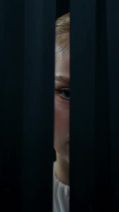 | ตาข้างเดียวแอบมองผ่านช่องม่าน แฟลชกล้องแว้บสะท้อนในตา *(เอาช็อตตาจากคลิปเดิมขึ้นมาเปิดแทนไมค์ เพราะมีคนและอารมณ์ทันที)* | SFX: ชัตเตอร์รัว + เสียงหัวใจเริ่มเต้น VO: "อีกสามนาที…" TXT: **แถลงข่าวครั้งแรกในชีวิต** |
| **2** · 0:02–0:03.5 | 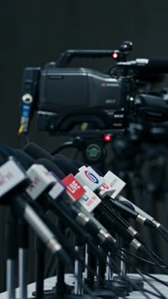 | แผงไมค์ช่องทีวี + ไฟแดง LIVE บนกล้อง ค่อยๆ ดันกล้องเข้า | SFX: เสียงจี่ไมค์เบาๆ TXT: 🔴 LIVE |
| **3** · 0:03.5–0:05 | 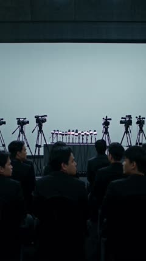 | มุมกว้าง นักข่าวเต็มห้องนั่งรอ โต๊ะแถลงยังว่าง | SFX: เสียงจอแจในห้อง |
| **4** · 0:05–0:07 | 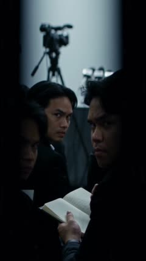 | นักข่าวหันขวับมาทางม่านแบบจับผิด *(ตัดสลับกับช็อต 1 ให้รู้ว่าเป็น POV ของเธอ เพราะ "พวกเขาเห็นเธอแล้ว")* แล้วม่านปิดฉับ | SFX: เสียงจอแจเงียบกริบ VO: "ทุกคนรอให้เราพลาด" |
| **5** · 0:07–0:09 | 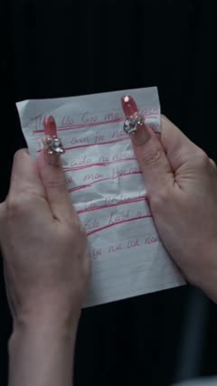 | มือกำโพยสคริปต์ที่ขีดฆ่า แล้วขยำจนยับ *(แนะนำซ้อนตัวหนังสือไทยที่อ่านออกในขั้นตัดต่อ เช่น ~~"ขอบคุณทุกท่านที่มา…"~~ ~~"ดิฉันขอ…"~~ เพราะตัวหนังสือที่ AI เจนอ่านไม่ออก)* | SFX: กระดาษขยำ (ชัดๆ แบบ ASMR) VO: "เขียนใหม่กี่รอบ… ก็ยังไม่ใช่เรา" |
| **6** · 0:09–0:11 | 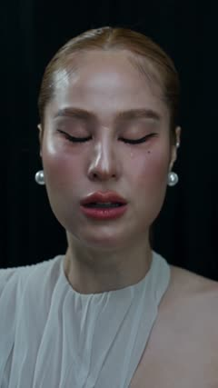 | หลับตา น้ำตาหยดเดียวไหลลงแก้ม *(สโลว์ 70%)* | SFX: เสียงหัวใจหยุด แล้วเงียบสนิท 1 จังหวะ VO: "ถ้าพูดผิดแค่คำเดียว…" |

### องก์ 2: พิธีกรรมหน้ากระจก (0:11–0:25) · ค่อยๆ เกรดสีจากเย็นไปอุ่น

| ช็อต / เวลา | ภาพ | สิ่งที่เห็น / กล้อง | เสียง · VO · TXT |
|---|---|---|---|
| **7** · 0:11–0:13 | 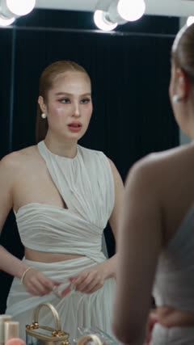 | หน้ากระจกไฟหลอดกลม หายใจลึก เปิดกล่องทอง | ดนตรี: เปียโนโน้ตเดียวเข้ามาแทนความเงียบ |
| **8** · 0:13–0:14.5 | 🆕 **N1** | **โชว์สินค้าในมือให้ชัด** หยิบ UZI Lip Matte ขึ้นมา ฉลากหันเข้ากล้อง ไฟโบเก้ด้านหลัง | SFX: เสียงเปิดฝา "คลิก" (ASMR) TXT: UZI Matte Liquid Lipstick |
| **9** · 0:14.5–0:17.5 | 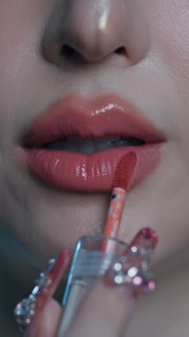 | มาโครทาลิป เห็นเนื้อสัมผัสชัด | SFX: เสียงปาดลิป ASMR TXT (คอลเอาต์): **เนื้อแมทนุ่มลื่น** · **ไม่ตกร่อง** · **กลบสีปากคล้ำมิด** |
| **10** · 0:17.5–0:18.5 | 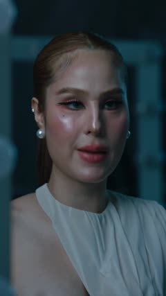 | เม้มปาก "อึ้ม" | SFX: เสียงเม้มปาก "ป๊อบ" |
| **11** · 0:18.5–0:21 | 🆕 **N2** *(ถ่ายจริง)* | **ช็อตพิสูจน์:** ใช้ทิชชู่ซับน้ำตาใต้ตา แล้วกดทิชชู่ลงบนปากเบาๆ ตัดไปมาโครทิชชู่ที่ **สะอาด ไม่มีสีลิปติด** | ดนตรีเริ่มมีจังหวะ TXT: **น้ำตาไหลได้… แต่ลิปไม่หลุด** TXT เล็ก: ไม่ติดทิชชู่ |
| **12** · 0:21–0:23 | 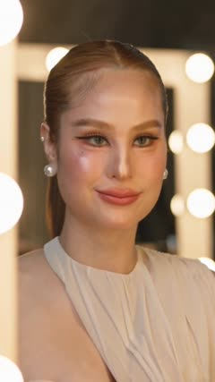 | มองตัวเองในกระจก มุมปากค่อยๆ ยิ้ม *(จุดเปลี่ยนของเรื่อง ให้แสงอุ่นเต็มที่ตรงนี้)* | VO: "โอเค… นี่แหละตัวเรา" |
| **13** · 0:23–0:25 | 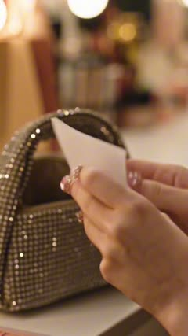 + 🆕 **N3** | ใส่ลิปลงคลัตช์ หยิบ **โพยที่ขยำ** ขึ้นมา (กำหนดให้กระดาษขาวในคลิปเดิมคือโพยนี้) มองแวบเดียว แล้ว **วางทิ้งไว้บนโต๊ะเครื่องแป้ง** ช็อตปิดเปลี่ยนโฟกัส ให้โพยชัดอยู่ข้างหน้า ส่วนเธอเดินห่างออกไปจนเบลอ | SFX: วางกระดาษ + เสียงส้นสูงเดินออก *(ไม่ต้องมี TXT เพราะภาพเล่าเองว่าเธอ "ทิ้งสคริปต์")* |

### องก์ 3: ออกไปเผชิญ (0:25–0:40) · โทนทองอุ่นเต็มที่

| ช็อต / เวลา | ภาพ | สิ่งที่เห็น / กล้อง | เสียง · VO · TXT |
|---|---|---|---|
| **14** · 0:25–0:28 | 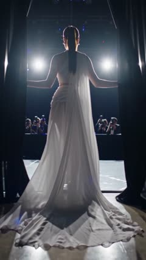 | ถ่ายจากด้านหลัง เธอแหวกม่านเดินออกไป แฟลชรัว | ดนตรี: **บิลด์ขึ้นเต็มที่** + ชัตเตอร์รัว |
| **15** · 0:28–0:29.5 | 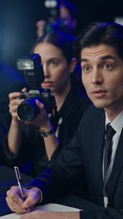 → 🆕 **N4** | นักข่าวหยุดเขียน เงยหน้าอึ้ง *(ควรเจนใหม่ให้เป็นนักข่าวชุดเดียวกับองก์ 1 ดูข้อ 8)* | SFX: ปากกาหยุด เสียงจอแจเงียบ |
| ⚡ ทรานซิชัน | | **แฟลชขาวเต็มจอ** ตัดไปที่โต๊ะแถลง เพื่อแก้ปัญหาตำแหน่งเวทีไม่ต่อเนื่องแบบประหยัด | SFX: แฟลช "ฟึ่บ" |
| **16** · 0:29.5–0:31 *(ใส่หรือไม่ใส่ก็ได้)* | 🆕 **N5** *(ถ่ายจริง)* | นั่งที่โต๊ะแถลง จิบน้ำจากแก้ว วางลง แล้วมาโครขอบแก้วที่ **สะอาด ไม่มีรอยลิป** | TXT เล็ก: **ไม่ติดแก้ว** |
| **17** · 0:31–0:35 | 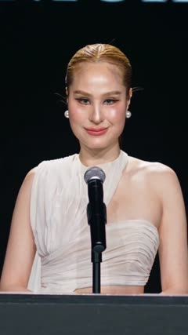 + 🆕 **N6** | หน้าแผงไมค์ชุดเดียวกับช็อต 2 (ให้เปิดและปิดเรื่องด้วยภาพเดียวกัน) เธอหลับตาครู่หนึ่ง ลืมตา แล้วพูด ก่อนยิ้ม | **เสียงจริงของเธอ (ใส่ซับ):** "วันนี้… ฉันไม่ได้เตรียมสคริปต์มาค่ะ" *(เว้นจังหวะ)* "ฉันเตรียมมาแค่ความมั่นใจ" |
| **18** · 0:35–0:40 | 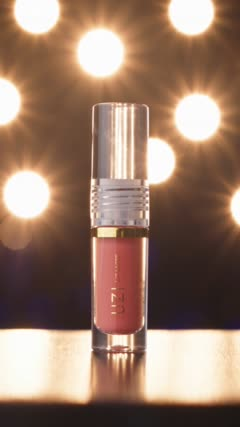 + การ์ดปิดท้าย | ภาพสินค้าฮีโร่บนไฟโบเก้ แล้วขึ้นการ์ดปิดท้าย | VO แบรนด์: "ทุกคนมีวันแถลงข่าวของตัวเอง… **UZI Matte Liquid Lipstick** มั่นใจได้ ตั้งแต่ริมฝีปาก" **การ์ดปิดท้าย:** โลโก้ UZI · ชื่อรุ่น · เบอร์สี [ระบุ] · จุดเด่น 2–3 ข้อ · [โปรโมชั่น] · **กดตะกร้าเลย 🛒** |

> **เรื่องลิปซิงก์ช็อต 17:** ปากในคลิปเดิมขยับไม่ตรงกับบทภาษาไทย แก้ได้ 2 ทาง (1) ใช้เครื่องมือลิปซิงก์ (เช่น OmniHuman / Kling Avatar) เจนช็อตนี้ใหม่จากเสียงพากย์จริง หรือ (2) วางประโยคแรกเป็น VO ตอนเธอหลับตา (ปากปิด) แล้วให้ประโยคที่สองตรงกับตอนเธอยิ้ม

---

## 5. ตอนจบทางเลือก B: "พลิกมุก" (แนะนำสำหรับ TikTok / แอด)

ใช้แทนช็อต 17–18 เมื่ออยากได้ยอดคอมเมนต์ แชร์ และยอดขายมากกว่าความซึ้ง

1. เธอพูดว่า "ฉันเตรียมมาแค่ความมั่นใจ" ห้องเงียบ
2. นักข่าว (ช็อต 15) ยกมือ: **"ขอถามคำถามเดียวค่ะ…"** ทั้งห้องเอนตัวเข้ามาฟัง
3. **"…ลิปสีอะไรคะ?"**
4. 🆕 เธอยิ้มมุมปาก แล้วยกลิป UZI ขึ้นหันเข้ากล้อง แฟลชรัวทั้งห้อง
5. ตัดเข้าภาพสินค้าฮีโร่ + TXT: **"คำตอบอยู่ในตะกร้า 🛒"** + เบอร์สี + โปร

> แบบนี้ช่วยตอบคำถามที่ค้างอยู่ว่า "ทำไมนักข่าวถึงอึ้ง" (เพราะเธอสวยจนต้องถาม) และทำให้สินค้าเป็นคำตอบของเรื่องตรงๆ

---

## 6. เวอร์ชันตัด 15 วินาที (สำหรับยิงแอด)

| วิ | ช็อต | หมายเหตุ |
|---|---|---|
| 0–1.5 | 1 ตาหลังม่าน + TXT "แถลงข่าวครั้งแรกในชีวิต" | Hook |
| 1.5–3 | 5 ขยำโพย | |
| 3–4.5 | 6 น้ำตาไหล | |
| 4.5–7.5 | 8+9 หยิบลิป + ทาลิป มาโคร + คอลเอาต์ | สินค้าต้องเข้าก่อนวิที่ 5 |
| 7.5–9.5 | 11 ทิชชู่สะอาด + "น้ำตาไหลได้ แต่ลิปไม่หลุด" | ช็อตพิสูจน์ |
| 9.5–11.5 | 14 เดินออกเวที แฟลชรัว | |
| 11.5–13.5 | 17 "ฉันเตรียมมาแค่ความมั่นใจ" + ยิ้ม | |
| 13.5–15 | 18 ภาพสินค้า + โปร + CTA | |

---

## 7. ช็อตใหม่ที่ต้องถ่าย/เจนเพิ่ม (พร้อม Prompt)

**คำอธิบายตัวละคร (ใส่ทุก prompt เพื่อให้หน้าเหมือนเดิม และแนบภาพอ้างอิงทุกครั้ง):**
`Thai woman, sleek center-parted low ponytail in light honey-brown, white asymmetric one-shoulder draped chiffon gown, large pearl earrings, long pink jeweled nails, sharp winged eyeliner, coral-rose matte lips`

| รหัส | ช็อต | วิธีทำ | Prompt (ภาษาอังกฤษ ใช้กับ Dreamina / Seedance / Kling) |
|---|---|---|---|
| **N1** | โชว์สินค้าในมือ | **ถ่ายสินค้าจริง** หรือเจนแล้วแปะภาพสินค้าจริงทับในขั้นตัดต่อ (AI มักเจนโลโก้และตัวหนังสือบนแพ็กเกจเพี้ยน) | `Extreme close-up, a hand with long pink jeweled nails lifts a slim clear liquid lipstick tube with gold band from a gold vanity case, label facing camera, warm vanity-bulb bokeh, shallow depth of field, slow push-in, cinematic, 9:16` |
| **N2** | ทิชชู่สะอาด | **ต้องถ่ายจริงด้วยสินค้าจริงเท่านั้น** (ดูหมายเหตุด้านล่าง) | (ใช้เป็นภาพอ้างอิงจัดเฟรม) `Close-up at a vanity mirror, the woman dabs a tear under her eye with a white tissue, then gently presses the tissue to her lips; macro insert of the tissue, clean, warm light` |
| **N3** | ทิ้งโพยไว้ | เจนได้ | `Rack focus: a crumpled handwritten speech note with red crossed-out lines lies on a vanity table in sharp foreground beside a gold case; in the background the woman in a white draped gown walks away toward a black curtain, out of focus; warm bulb bokeh, 9:16` |
| **N4** | นักข่าวอึ้ง (เจนใหม่) | เจนได้ ใช้ภาพจากช็อต 3–4 เป็นอ้างอิง | `Thai male reporter in a black suit in a dim press room with cool grey-blue light, writing in a small notebook, slowly looks up, stunned, camera flashes flickering on his face, 9:16` |
| **N5** | ขอบแก้วสะอาด | **ต้องถ่ายจริงด้วยสินค้าจริงเท่านั้น** | (ใช้เป็นภาพอ้างอิงจัดเฟรม) `Press table, the woman sips from a clear water glass and sets it down; macro of the glass rim, clean, warm key light` |
| **N6** | พูดหน้าแผงไมค์ | เจนได้ หรือใช้ลิปซิงก์ | `Medium shot, the woman sits at a press table behind a bank of eight broadcast microphones with colorful TV-station flags, plain dark backdrop, soft warm key light, she opens her eyes and speaks calmly, then smiles, 9:16` |

> ⚠️ **ช็อตพิสูจน์คุณสมบัติ (N2 ทิชชู่, N5 แก้ว) ห้ามใช้ AI เจน** เพราะเป็นการแสดงผลลัพธ์ของสินค้า ถ้าภาพไม่ได้มาจากการใช้สินค้าจริงจะเข้าข่ายโฆษณาเกินจริง ควรถ่ายจริง (เก็บคลิปดิบไว้เป็นหลักฐาน) และ **ใช้เฉพาะคำเคลมที่แบรนด์ยืนยันได้** (เช่น ไม่ติดแก้ว, ออร์แกนิก) ก่อนขึ้นจอ

---

## 8. จุดแก้ความต่อเนื่อง (Continuity)

| ปัญหาในคลิปเดิม | วิธีแก้ |
|---|---|
| นักข่าวช่วงต้นเป็นผู้ชายไทยในห้องแสงเย็นทึม แต่ 0:23 กลายเป็นนายแบบฝรั่งในแสงฟ้า | เจนใหม่ (N4) ให้เป็นคนกลุ่มเดียวกันในห้องเดียวกัน |
| เปิดเรื่องด้วยแผงไมค์หลายตัวบนโต๊ะ แต่ตอนพูดเป็นไมค์ตัวเดียวบนขาตั้ง | ใช้แผงไมค์ชุดเดิมในช็อต 17 (N6) ให้เปิดและปิดเรื่องด้วยภาพเดียวกัน |
| เดินออกไปบนเวทีที่มีช่างภาพ แต่ตัดไปที่ไมค์ทันที | ใส่ทรานซิชันแฟลชขาวเต็มจอ หรือเพิ่มช็อตเดินไปนั่งที่โต๊ะ 1 วิ |
| ตัวหนังสือขอบบนช็อตไมค์ (0:25) เป็นอักษรมั่ว | ครอปซูมตัดออก เบลอ หรือแทนด้วยแบ็กดรอปโลโก้ UZI |
| ตัวหนังสือบนโพยอ่านไม่ออก (AI เจน) | ซ้อนข้อความไทยในขั้นตัดต่อ หรือทำให้หลุดโฟกัส |
| กระดาษขาวที่หยิบจากคลัตช์ไม่มีความหมาย | กำหนดให้เป็นโพยใบเดิม แล้วจบด้วยการทิ้งไว้ (N3) |
| ช็อตสินค้าปิดท้ายไม่มีข้อมูลขาย | เพิ่มการ์ดปิดท้าย: ชื่อรุ่น, เบอร์สี, จุดเด่น, โปร, CTA |

**เสียงและซับ:** ทั้งคลิปต้องมีซับไทยฝังในวิดีโอ ใส่ SFX แบบ ASMR (เปิดฝาลิป, ปาดลิป, เม้มปาก, ขยำกระดาษ) เพราะเป็นเสียงที่ทำให้คนดูรู้สึกถึงเนื้อลิป ส่วนดนตรีควรไล่จาก **เสียงทุ้มตึงเครียด → เงียบ → เปียโนโน้ตเดียว → บิลด์ขึ้นตอนเดินออก → ปิดด้วยเสียงอบอุ่นตอนภาพสินค้า**

---

## 9. คะแนนก่อน/หลัง ตามเกณฑ์ 7 Wow · 8 Offer · 9 Angel

*(ประเมินโดยดูจากเนื้อหาคลิป เป็นความเห็นเชิงครีเอทีฟ ไม่ใช่ผลจากระบบ)*

| เกณฑ์ (เต็ม 10) | คลิปเดิม | เวอร์ชันใหม่ (เป้าหมาย) | สิ่งที่เปลี่ยน |
|---|---|---|---|
| **7 Wow (Hook)** | 6.5 | 8.5 | เปิดด้วยตาหลังม่านพร้อม TXT "แถลงข่าวครั้งแรกในชีวิต" แทนภาพไมค์นิ่งๆ ทำให้รู้เรื่องตั้งแต่ 2 วิแรก |
| **8 Offer (Value)** | 4.0 | 8.0 | มีชื่อสินค้า ช็อตพิสูจน์ (ทิชชู่/แก้ว) คอลเอาต์จุดเด่น การ์ดปิดท้ายพร้อมโปรและ CTA |
| **9 Angel (Brand)** | 8.0 | 9.0 | ภาพลุคหรูเข้าถึงได้ (Accessible Luxury) ทำไว้ดีแล้ว เพิ่มประโยคแบรนด์ "มั่นใจได้ ตั้งแต่ริมฝีปาก" และความปลอดภัย/ออร์แกนิกในการ์ดปิด |
| **รวม (30)** | **18.5** ⚠️ ควรแก้ | **25.5** 🔥 พร้อมยิงแอด | |

---

### ต่อยอดเป็นซีรีส์
"ทุกคนมีวันแถลงข่าวของตัวเอง" ทำต่อได้เป็นตอนๆ ใช้โครงเรื่องเดิม (กลัว → ลิป → มั่นใจ) เปลี่ยนแค่เวที เช่น **EP2 สัมภาษณ์งาน** · **EP3 พรีเซนต์ลูกค้าใหญ่** · **EP4 เจอพ่อแม่แฟนครั้งแรก**
